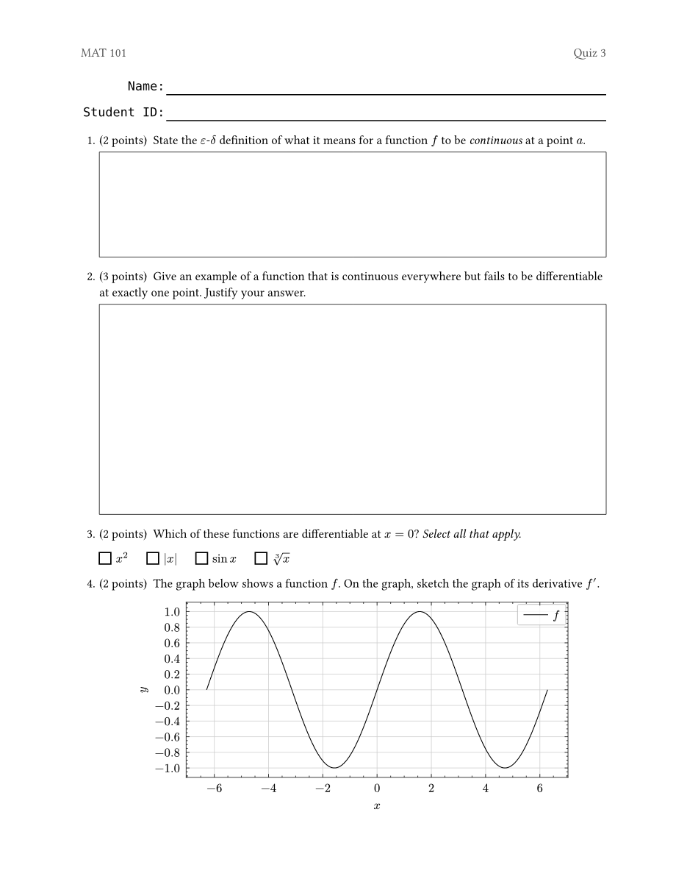
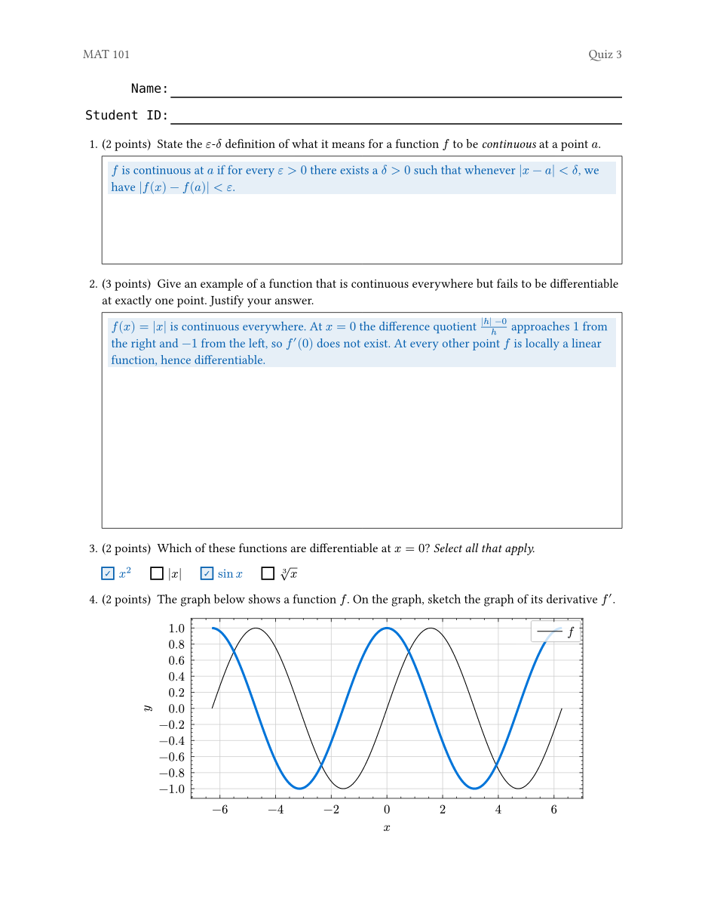
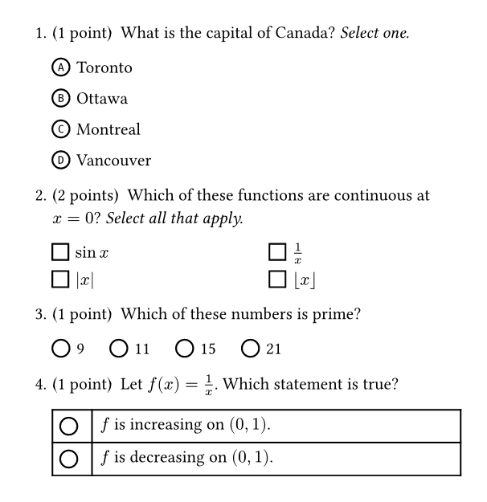
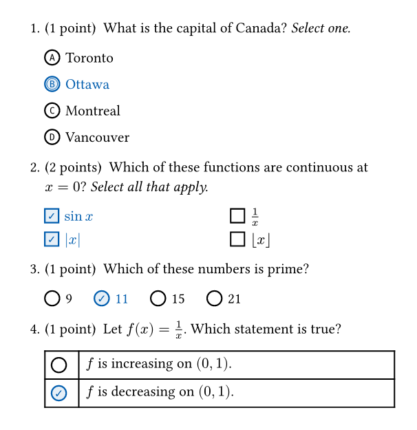

<h1 align="center">
  <a href="https://siefkenj.github.io/typst-examy/"></a>
</h1>

**[Full Documentation](https://siefkenj.github.io/typst-examy/)** |
**[Playground](https://siefkenj.github.io/typst-examy/playground.html)**

A [Typst](https://typst.app) package for writing exams, quizzes, and homework
with automatically numbered questions, answer boxes, points accounting, smart
cross-references, and solutions that can be toggled on and off. This package
follows the spirit of the [exam class for LaTeX](https://ctan.org/pkg/exam?lang=en).

<p align="center">
  
  
</p>
<p align="center"><em><a href="examples/quiz.typ">examples/quiz.typ</a>, compiled without and with solutions.</em></p>

Full documentation is available at the [Examy website](https://siefkenj.github.io/typst-examy/)
or downloadable as a [PDF](https://siefkenj.github.io/typst-examy/examy-manual.pdf).
See the
[examples/](examples/) folder for sample documents.

## Quick start

A basic document looks like this:

```typst
#import "@preview/examy:1.0.0": *

#show: exam.with(show-solutions: false)

// A fill-in block (Name / Student ID) at the top of the page
#{
  set text(font: "DejaVu Sans Mono")
  name-block()
}

#question(points: 2)[
  State the definition of a _continuous function_.
  #answer-box(height: 1fr)[
    #solution[A function $f$ is continuous at $a$ if
      $lim_(x -> a) f(x) = f(a)$.]
  ]
]
#question(points: 3)[
  Give an example of a continuous function that is not
  differentiable.
  #answer-box(height: 2fr)[
    #solution[$f(x) = abs(x)$, at $x = 0$.]
  ]
]
```
A quick-start template is available by choosing examy under _Start from template_ in the Typst web app or on the command line by running

```bash
typst init @preview/examy
```

## Features

- **[Questions, parts, and subparts](https://siefkenj.github.io/typst-examy/questions.html)**,
  numbered automatically.
- **[Points](https://siefkenj.github.io/typst-examy/points.html)**: points listed on a per-question basis as well as points tables and points per page displays.
- **[Answer boxes](https://siefkenj.github.io/typst-examy/answer-boxes.html)** providing a student with space to write. These can have a fixed size or can use available space via fractional units (e.g. `height: 1fr`).
- **[Solutions](https://siefkenj.github.io/typst-examy/solutions.html)**: written solutions can be globally toggled as visible/invisible to make answer-key and blank versions of a test.
- **[Rubrics](https://siefkenj.github.io/typst-examy/rubrics.html)**: annotate questions and solutions with grading rubrics (positive or negative points), exportable as JSON.
- **[Multiple choice](https://siefkenj.github.io/typst-examy/choices.html)**
  with round or square bubbles, optionally enumerated.
- **[Smart cross-references](https://siefkenj.github.io/typst-examy/cross-references.html)**:
  a `@name` reference to a question will show a minimal string that uniquely identifies the question/part/subpart.
- **[Cover pages](https://siefkenj.github.io/typst-examy/cover-pages.html)**: basic commands for creating name/exam info areas.

<p align="center">
  
  
</p>

## Basic API Reference

<!-- API-DOCS-START — AUTOGENERATED -- DO NOT EDIT. Generated by make_docs.sh from docs/readme-api.typ; edit the rows there. -->
All names below are exported by `#import "@preview/examy:1.0.0": *`. See the [full reference](https://siefkenj.github.io/typst-examy/reference.html) for all arguments.

| Export | |
| --- | --- |
| [`#answer-box[..]`](https://siefkenj.github.io/typst-examy/reference/answer-box.html) | A box for students to write answers in. |
| [`#choice[..]`](https://siefkenj.github.io/typst-examy/reference/choice.html) | A round or square bubble (used for multiple-choice questions) followed by the choice it labels. |
| [`#choices[..]`](https://siefkenj.github.io/typst-examy/reference/choices.html) | An enumerate environment for multiple-choice answers. Every list item gets turned into a `#choice`, with a round/square bubble as its list marker. |
| [`config`](https://siefkenj.github.io/typst-examy/reference/config.html) | Global configuration of package options. Give options to the exam, e.g. `#show: exam.with(show-solutions: true)`, or set them with `#show: e.set_(config, show-solutions: true)`. |
| [`e`](https://siefkenj.github.io/typst-examy/reference/e.html) | A re-export of [elembic](https://typst.app/universe/package/elembic), used mainly for `e.set_`. |
| [`#exam[..]`](https://siefkenj.github.io/typst-examy/reference/exam.html) | Lays out an exam. Start one with `#show: exam` (or `#show: exam.with(..)`, with `config` options). |
| [`#maketitle(..)`](https://siefkenj.github.io/typst-examy/reference/maketitle.html) | The exam title block (in the spirit of LaTeX's `\maketitle`). Exam information is read from the global `config`. |
| [`#name-block(..)`](https://siefkenj.github.io/typst-examy/reference/name-block.html) | A block of fill-in rows for a student to write their name. |
| [`#points-table(..)`](https://siefkenj.github.io/typst-examy/reference/points-table.html), [`#num-points(..)`](https://siefkenj.github.io/typst-examy/reference/num-points.html), [`#num-questions()`](https://siefkenj.github.io/typst-examy/reference/num-questions.html) | A scoring table, and the exam's points and number of questions as numbers, which need context (e.g. `#context num-points()`). |
| [`#question[..]`](https://siefkenj.github.io/typst-examy/reference/question.html), [`#part[..]`](https://siefkenj.github.io/typst-examy/reference/question.html#api-part), [`#subpart[..]`](https://siefkenj.github.io/typst-examy/reference/question.html#api-subpart) | Declare a question, part, or subpart — numbered `1.`, `(a)`, or `i.` respectively. |
| [`#rubric[..]`](https://siefkenj.github.io/typst-examy/reference/rubric.html), [`#rubric-list()`](https://siefkenj.github.io/typst-examy/reference/rubric-list.html) | Grading rubric items for a question, part, or subpart, drawn on the graders' copy, and every rubric of the exam as a list. |
| [`#solution[..]`](https://siefkenj.github.io/typst-examy/reference/solution.html) | Declare a solution to a question, part, or subpart; this is only rendered if the config option to show solutions is enabled. |
<!-- API-DOCS-END -->

## License

MIT

## Development

Developed with Typst 0.15. A [dev container](.devcontainer) is provided for development.

The following commands are useful for development.

```bash
# run the test suite (asserts + a full-pipeline integration document)
./tests/run.sh
```

The documentation site is built with Typst's bundle and HTML export from
docs/site.typ: the guide pages are in docs/site/pages/, and every example on
them is rendered by the package from the code it shows. Its live editor
(docs/site/live.ts, which recompiles an edited example in the browser with
[typst.ts](https://github.com/Myriad-Dreamin/typst.ts)) is bundled by Vite.
The dev container installs Node and the npm dependencies.

```bash
# serve the site at http://localhost:5173, rebuilding it whenever the
# package or the docs change and reloading the browser
npm run dev

# build the site into _site/ (the pages, then the live editor), and serve
# that build
npm run build
npm run preview
```

The site is published to GitHub Pages by .github/workflows/pages.yml on
every push to main. `docs/site/build.sh` builds the pages alone, without the
live editor.

```bash
# the same pages and the reference as one PDF
typst compile --root . docs/manual.typ examy-manual.pdf
```

```bash
# regenerate the Basic API Reference of this README (between the
# API-DOCS-START/END markers above), from docs/readme-api.typ
./make_docs.sh
```

The API documentation has a single source: the declarations themselves.
elembic elements (`config`, `solution`) are introspected with
`e.data(..)`, and the plain functions declare their arguments with
`e.field` through `declare_function` (src/signature.typ), the same spec
that checks every call's arguments. docs/api.typ reads both, for the
site's reference; an export with no documentation fails the build. The
README's Basic API Reference is a hand-picked overview: its rows and their
descriptions are written in docs/readme-api.typ, and only its links and
signatures come from the declarations.

```bash
# build the publishable package in dist/examy/<version>/ — the folder to
# copy into typst/packages under packages/preview/. Runs the tests,
# compiles the examples, regenerates the README screenshots, rewrites
# example imports to @preview/examy, and validates the result via
# TYPST_PACKAGE_PATH (CI does the same and compiles a smoke-test document
# against the vendored package). Requires --tag=<TAG> or --no-tag — see
# below and `./make_dist.sh` with no arguments for why.
./make_dist.sh --tag=v1.0.0   # or: ./make_dist.sh --no-tag
```

### Making a release

1. Bump `version` in `typst.toml` — the elembic prefix, the example
   imports, and the dist layout all derive from it. Also update the
   `#import "@preview/examy:<version>"` line in `template/main.typ` (the
   `typst init` template ships verbatim, so it isn't rewritten;
   `make_dist.sh` refuses to build if it doesn't match).
2. Commit, tag, and push:
   ```bash
   git commit -am "Release v1.0.0"
   git tag v1.0.0
   git push && git push origin v1.0.0
   ```
   The tag needs to already be on GitHub before the next step, since the
   README's links are rewritten to permalinks pinned at it.
3. Run `./make_dist.sh --tag=v1.0.0` (matching the tag from step 2). If the
   tests and validation pass, it produces `dist/examy/<version>/` containing
   the package exactly as it should be published (example imports rewritten
   to `@preview/examy:<version>`, this Development section stripped from
   the README, relative links rewritten to permalinks at the tag, the
   template's `thumbnail.png` rendered from page 2 of `template/main.typ`).
4. Copy `dist/examy/<version>` into a fork of
   [typst/packages](https://github.com/typst/packages) as
   `packages/preview/examy/<version>` and open a pull request.
